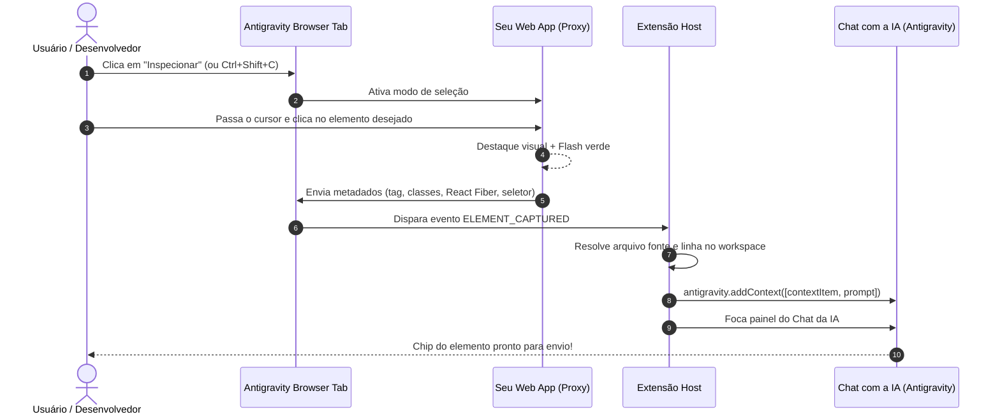

<div align="center">

# 🌐 Antigravity Browser & UI Inspector

**Aba de Navegação Embutida com Seletor Visual de Elementos DOM integrada ao Chat de IA do Google Antigravity IDE.**

[](https://github.com/gabrielbolzani/antigravity-browser)
[](https://opensource.org/licenses/MIT)
[](https://antigravity.google)
[](https://github.com/gabrielbolzani/antigravity-browser/pulls)

<p align="center">
  <i>Inspecione qualquer elemento da interface do seu webapp local e envie-o diretamente para o chat da IA com 1 clique — com arquivo fonte, linha exata do código e metadados.</i>
</p>

[Recursos](#-principais-recursos) • [Como Funciona](#-como-funciona) • [Instalação](#-instalação) • [Atalhos](#-atalhos-de-teclado) • [Arquitetura](#-arquitetura-interna) • [Licença](#-licença)

</div>

---

## 💡 Por que o Antigravity Browser?

Quando desenvolvemos interfaces frontend com assistência de inteligência artificial, explicar qual botão, card, div ou componente precisa ser alterado costuma ser demorado e impreciso.

O **Antigravity Browser** resolve isso trazendo a experiência consagrada de *Browser Tab & UI Inspector* nativamente para o **Google Antigravity IDE**:

1. **Você abre seu webapp em uma aba ao lado do código**.
2. **Ativa a ferramenta de inspeção visual**.
3. **Clica em qualquer elemento na tela**.
4. **O elemento vira automaticamente um chip de contexto no chat da IA** (`@Component.tsx:42`), já abrindo o arquivo exato no editor com foco imediato no chat.

---

## ✨ Principais Recursos

### 🎯 1. Seletor Visual Interativo (Element Inspector)
- **Hover Preciso**: Passe o cursor sobre botões, títulos, inputs ou formulários para visualizar um retângulo delimitador azul com as dimensões exatas (`L × A`) e seletor da tag/classes.
- **Feedback Tátil**: Ao clicar, o elemento pisca em verde confirmando a captura e trava a navegação acidental da página.
- **Detecção React Fiber & Vue**: Lê automaticamente propriedades internas do React (`_debugSource`, `memoizedProps`) e componentes Vue (`__vueParentComponent`) para extrair o nome do componente (`<AuthForm>`, `<Button>`) e o caminho real do arquivo fonte com a linha de declaração.
- **Busca Heurística no Workspace**: Caso o app não exponha metadados de desenvolvimento ou use SSR/HTML puro, a extensão vasculha seu workspace por IDs, classes CSS exclusivas ou texto para encontrar o arquivo correspondente.
- **Snapshot Automático de Referência**: Para elementos criados puramente em runtime (sem arquivo fixo), gera um snapshot limpo em `.antigravity/elemento-selecionado.html`.

### ⚡ 2. Reconhecimento Automático de Portas (Zero-Config)
- Detecta automaticamente servidores locais em execução no terminal (`Vite`, `Next.js`, `Fastify`, `Astro`, `Remix`, `SvelteKit`, `Angular`, etc.).
- Suporte a conexões **IPv4 (`127.0.0.1`)** e **IPv6 (`::1`)** no Windows e Linux.
- Monitoramento contínuo: assim que você roda `npm run dev`, o botão da porta ativa (ex: `⚡ :8080`) surge na barra de ferramentas para alternância instantânea.

### 📱 3. Alternador de Visualização Responsiva
- 💻 **Modo PC / Desktop**: aproveita 100% da área da aba com fidelidade completa de tela cheia.
- 📱 **Modo Celular (Mobile View)**: moldura de smartphone de alta resolução (390 × 844 px) com proporção mantida, cantos arredondados, sombra realista e rolagem suave.
- 📟 **Modo Tablet**: pré-visualização em resolução de tablet (768 × 1024 px).
- 🔄 **Alternar Orientação**: botão dedicado para girar o dispositivo entre modo Retrato (*Portrait*) e Paisagem (*Landscape*).

### 🛡️ 4. Proxy Reverso Transparente
- Contorna restrições de segurança de iframes: remove cabeçalhos `X-Frame-Options`, `Content-Security-Policy` restritivos e políticas `Cross-Origin`.
- Preserva **Vite HMR (Hot Module Replacement)**, WebSockets, folhas de estilo CSS, scripts TypeScript/JavaScript, fontes e imagens locais.
- Injeta o motor do inspetor de forma isolada sem poluir o build ou o código de produção do seu projeto.

---

## 🛠️ Como Funciona o Fluxo de Contexto



---

## 🚀 Instalação

### Opção 1: Clonar e Instalar Localmente (Recomendado)

Você pode instalar a extensão diretamente no seu diretório de extensões do Antigravity IDE ou VS Code:

```bash
# Clone o repositório
git clone https://github.com/gabrielbolzani/antigravity-browser.git

# Copie para a pasta de extensões do Antigravity IDE (Windows PowerShell):
$dest = "$HOME\.antigravity-ide\extensions\antigravity-community.antigravity-browser-0.1.3"
New-Item -ItemType Directory -Path $dest -Force
Copy-Item -Path .\antigravity-browser\* -Destination $dest -Recurse -Force
```

*No Linux / macOS:*
```bash
dest="$HOME/.antigravity-ide/extensions/antigravity-community.antigravity-browser-0.1.3"
mkdir -p "$dest"
cp -r antigravity-browser/* "$dest"
```

### Opção 2: Recarregar o Editor
Após copiar a pasta:
1. Abra o **Antigravity IDE** ou **VS Code**.
2. Pressione <kbd>Ctrl</kbd> + <kbd>Shift</kbd> + <kbd>P</kbd> (ou <kbd>Cmd</kbd> + <kbd>Shift</kbd> + <kbd>P</kbd> no Mac).
3. Selecione **`Developer: Reload Window`** (Recarregar Janela).
4. O ícone **🌐 Browser Tab** aparecerá na barra de status inferior.

---

## ⌨️ Atalhos de Teclado & Comandos

| Comando | Descrição | Atalho Padrão |
| :--- | :--- | :--- |
| `antigravity-browser.open` | Abre a aba do navegador embutido | Barra de status / Menu |
| `antigravity-browser.inspect` | Ativa ou desativa a seleção de elemento | <kbd>Ctrl</kbd> + <kbd>Shift</kbd> + <kbd>C</kbd> |
| `Cancelar Inspeção` | Sai do modo de inspeção sem selecionar | <kbd>ESC</kbd> |

---

## ⚙️ Configurações Disponíveis

Você pode personalizar o comportamento no `settings.json`:

```json
{
  "antigravityBrowser.defaultUrl": "http://localhost:8080",
  "antigravityBrowser.autoDetectPort": true,
  "antigravityBrowser.proxyPort": 38888,
  "antigravityBrowser.defaultDevice": "desktop",
  "antigravityBrowser.autoAddToChat": true,
  "antigravityBrowser.autoCopyContext": true,
  "antigravityBrowser.openSourceFile": true
}
```

---

## 🧩 Estrutura do Projeto

```
antigravity-browser/
├── extension.js          # Ponto de entrada, servidor de proxy reverso e integração com API VS Code / Antigravity
├── inspector.js          # Script cliente injetado na página para hover, highlight e captura do React Fiber
├── package.json          # Metadados da extensão, contribuições de comandos e menus
├── README.md             # Documentação completa
└── LICENSE               # Licença MIT
```

---

## 🤝 Contribuindo

Contribuições, sugestões e relatórios de bugs são muito bem-vindos!

1. Faça um Fork do projeto (`https://github.com/gabrielbolzani/antigravity-browser/fork`).
2. Crie uma Branch para sua Feature (`git checkout -b feature/MinhaNovaFeature`).
3. Faça o Commit de suas mudanças (`git commit -m 'feat: Adiciona suporte a Svelte 5 Fiber'`).
4. Envie para o Branch (`git push origin feature/MinhaNovaFeature`).
5. Abra um **Pull Request**.

---

## 📄 Licença

Distribuído sob a licença **MIT**. Consulte o arquivo [`LICENSE`](LICENSE) para obter mais informações.

<div align="center">
  <sub>Desenvolvido com carinho por <a href="https://github.com/gabrielbolzani">Gabriel Bolzani</a> para a comunidade Antigravity IDE.</sub>
</div>
